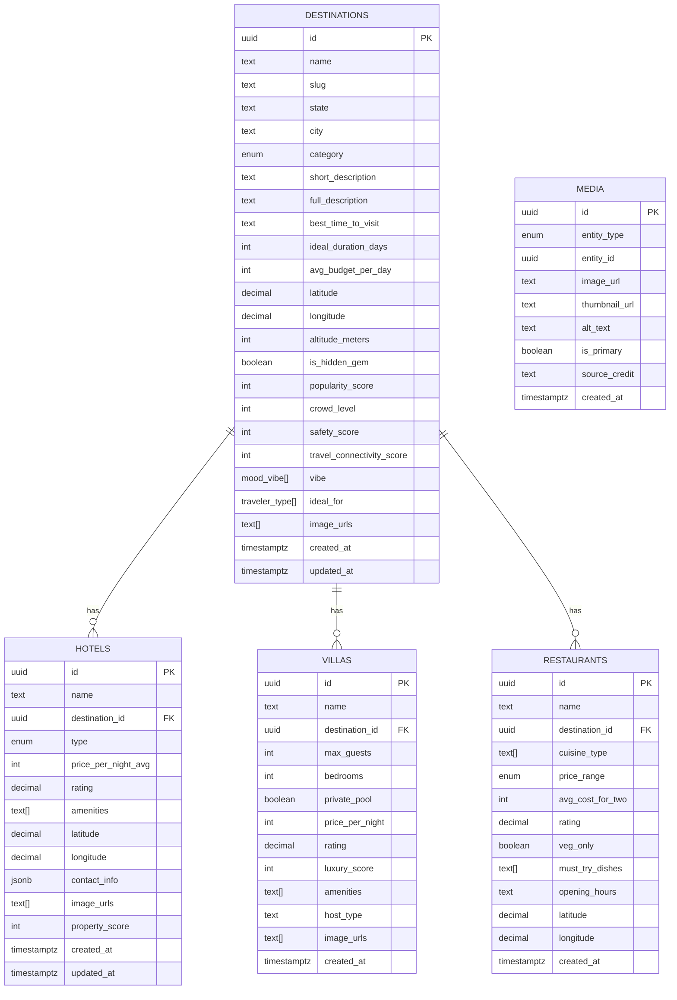

# 📊 MoodTrip AI - Database Documentation

This document outlines the database architecture, data dictionary, and indexing strategies for the MoodTrip AI platform.

## 1. ER Diagram (Mermaid)

## 2. Data Dictionary

### Destinations Table
| Field Name | Data Type | Description |
|------------|-----------|-------------|
| `id` | UUID | Primary key, auto-generated. |
| `name` | TEXT | Display name of the destination (e.g., "Varanasi"). |
| `slug` | TEXT | URL-friendly name (e.g., "varanasi"). Unique. |
| `state` | TEXT | Indian state (e.g., "Uttar Pradesh"). |
| `category` | Enum | Classification (Beach, Hill Station, etc.). |
| `vibe` | Array | Tags for AI matching (Peaceful, Party, etc.). |
| `is_hidden_gem`| Boolean| Flag for offbeat locations. |
| `popularity_score`| Integer| 0-100 score for trending/ranking. |

### Hotels Table
| Field Name | Data Type | Description |
|------------|-----------|-------------|
| `destination_id`| UUID | Foreign key to destinations. |
| `type` | Enum | Hotel, Resort, Hostel, etc. |
| `rating` | Decimal | User/Official rating (0.0 - 5.0). |
| `amenities` | Array | List of available services. |

---

## 3. Indexing Recommendations

To ensure low-latency queries in Supabase (PostgreSQL), we have implemented the following:

1.  **B-Tree Indexes**:
    *   `idx_dest_name`: For fast search by destination name.
    *   `idx_dest_state_city`: For regional filtering.
    *   `idx_dest_category`: For category-based exploration.
2.  **GIN Indexes**:
    *   `idx_dest_vibe`: **Crucial** for mood-based filtering using the `vibe` array.
    *   `idx_dest_ideal_for`: For group-type filtering.
3.  **Foreign Key Indexes**:
    *   `idx_hotel_dest_id`, `idx_villa_dest_id`, `idx_rest_dest_id`: Ensures joins between destinations and secondary tables are lightning-fast.

### Media Table
| Field Name | Data Type | Description |
|------------|-----------|-------------|
| `entity_type`| Enum | 'destination', 'hotel', 'restaurant', 'villa' |
| `entity_id` | UUID | Relational link to the parent entity. |
| `is_primary` | Boolean | True for the main display image. |
| `image_url` | TEXT | CDN-backed URL (Supabase/S3). |

---

## 5. Media Pipeline & Strategy (Phase 2.5)

To ensure high performance and visual reliability, we use a structured media pipeline:

### A. Storage Buckets
1. `destination-images`: Hero and gallery shots for locations.
2. `hotel-images`: Property and room images.
3. `restaurant-images`: Food and ambiance shots.

### B. Optimization Workflow
*   **Format**: Convert all images to **WebP** for superior compression.
*   **Compression**: Target size < 300kb for hero images, < 50kb for thumbnails.
*   **Resizing**: Server-side resizing using a pipeline (e.g., Supabase Image Transformation or Cloudinary).
*   **Fallback Logic**: API returns a default curated image if the `media` join is empty.

---

## 6. API Endpoints (Phase 2)

### Destinations
*   `GET /api/destinations`: List all destinations with optional filters (`state`, `tier`, `mood`, `category`).
*   `GET /api/destination/:slug`: Get detailed destination info including top hotels, restaurants, and villas in one call.
*   `GET /api/destinations/hidden-gems`: Returns curated offbeat locations ranked by trending score.

### Recommendation Engine
*   `POST /api/recommend`: Personalized trip matching.
    *   **Input**: `{ mood, budget, ideal_for, duration, preferred_state }`
    *   **Logic**: Weighted scoring based on the algorithm below.

---

## 5. Recommendation Algorithm (Weighted Ranking)

The engine calculates a `recommendation_score` (0-100) for each candidate:

| Weight | Component | Criteria |
|:---|:---|:---|
| **30%** | **Vibe Match** | Direct match between user mood and destination `vibe` array. |
| **20%** | **Budget Match** | Match between user budget tier and destination `avg_budget_per_day`. |
| **15%** | **Popularity** | Weighted by `popularity_score`. |
| **15%** | **Connectivity** | Weighted by `travel_connectivity_score` (1-5). |
| **10%** | **Safety** | Weighted by `safety_score` (1-5). |
| **10%** | **Traveler Match** | Match between `ideal_for` (Solo, Family, etc.) and user profile. |

---

## 7. Phase 4: Social & Community Layer (Current)

The platform has been upgraded to a community-driven travel ecosystem with the following additions:

### A. New Entities
*   **PROFILES**: Stores user public data, bio, travel styles, and social stats (`saved_trips_count`, `reviews_count`).
*   **REVIEWS**: Relational feedback system linked to destinations, hotels, and restaurants. Enforces "one review per user per entity".
*   **PUBLIC TRIPS**: The `trips` table now supports public sharing via `is_public` and `public_slug`.

### B. Automated Scoring 4.0
We have implemented **Database Triggers** that react to social activity:
1.  `tr_review_added`: On new review, it calculates the new average rating for the target entity (Destination/Hotel/Rest) and increments the user's review count.
2.  `tr_trip_count_change`: Updates the `saved_trips_count` on the user's profile automatically.
3.  `refresh_trending_scores()`: A new algorithmic function that ranks destinations based on:
    *   Review Volume (10.0 weight)
    *   Save Frequency (5.0 weight)
    *   Social Shares (2.0 weight)
    *   Global Popularity (0.5 weight)

### C. Privacy & Security
*   **Moderation**: A flagging system is prepared in the schema for inappropriate content.
*   **Ownership**: API endpoints strictly validate trip ownership for deletions and privacy toggling.

### D. Social Indices
*   `idx_reviews_dest` / `idx_reviews_user`: Optimizes view counts and profile listings.
*   `idx_trips_public_slug`: Enables lightning-fast lookup for shared trip pages.
*   `idx_profiles_username`: Critical for public profile vanity URLs.
